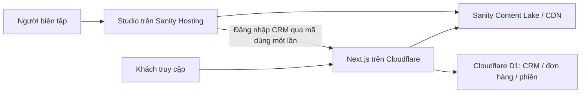

# Kế hoạch tách Sanity Studio khỏi Cloudflare Worker

Ngày khảo sát: 2026-11-12. Trạng thái: đã triển khai mã nguồn trong working tree; xem [runbook](SANITY_STUDIO_DEPLOYMENT.md) và [kết quả local](reviews/SANITY_STUDIO_SEPARATION_2026_11_12.md). Chưa deploy production. Các mục bên dưới ghi thiết kế và thứ tự dự kiến ban đầu.

## Quyết định kiến trúc

Tách Studio thành ứng dụng độc lập trong `studio/`, cùng repository, có `package.json`, `package-lock.json` và TypeScript config riêng. Deploy bằng Sanity Hosting tại `<ten-studio>.sanity.studio`. Giữ Next.js ở gốc để hạn chế thay đổi Cloudflare/OpenNext/D1. Chưa cần chuyển cả repo sang npm workspaces.

Website tiếp tục lấy nội dung từ cùng Sanity project/dataset qua API. Không cần chuyển dữ liệu, upload lại ảnh hoặc đổi document ID. Cloudflare không build hay phục vụ giao diện biên tập, schema và plugin Studio nữa.



Sanity khuyến nghị deploy Studio riêng; Studio là ứng dụng chạy trên trình duyệt, không cần Next.js server. Nguồn: [Embedding Studio](https://www.sanity.io/docs/studio/embedding-sanity-studio), [Hosting and deployment](https://www.sanity.io/docs/studio/deployment).

## Bằng chứng trong repo

| Vị trí | Hiện trạng và việc cần làm |
| --- | --- |
| `src/app/(studio)/studio/[[...tool]]/studio-client.tsx` | Import `sanity.config.ts` và `NextStudio`; đây là điểm kéo Studio vào Next build. |
| `studio-loader.tsx` cùng thư mục | Có `ssr: false`; vẫn sinh Studio client chunks và tốn công build/upload assets. Chưa có số đo chứng minh tỷ lệ Studio trong Worker server bundle. |
| `sanity.config.ts` | Chứa schema, actions, Presentation, media, assist, dashboard, vision và code input. Chuyển sang ứng dụng Studio. |
| `src/sanity/lib/client.ts` | `stega.studioUrl` đang là `/studio`; đổi thành URL Studio tuyệt đối. |
| `src/sanity/presentation.ts` | Preview đang dựa vào cùng origin; cần cấu hình origin website rõ ràng. |
| `src/sanity/ui/staff-sign-in-tool.tsx` | POST cùng origin tới `sanity-verify`, rồi mở `/admin`. Sẽ hỏng khi chuyển domain. |
| `src/app/(frontend)/api/admin/auth/sanity-verify/route.ts` | Chỉ chấp nhận Origin của website và đặt cookie tại website. Không thể đổi mỗi URL fetch là xong. |
| `src/sanity/actions/smart-*-importer.tsx` | Gọi `/api/sanity/import-*`, tải `/api/sanity/guide-*`; cần tách xử lý và đường dẫn. |
| `src/sanity/ui/management-hub-launcher.tsx` | Link `/admin` cần chuyển thành URL website. |
| `.github/workflows/verify.yml` | Mọi push/PR hiện build Cloudflare; cần job Studio và phạm vi thay đổi riêng. |
| `tsconfig.json` | Include `**/*.ts(x)`; phải exclude `studio` để Next typecheck không kéo Studio trở lại. |

## Ranh giới mã nguồn và dependencies

```text
deancore-engine/
├── package.json / package-lock.json   # Website và Cloudflare
├── src/
│   ├── app/                          # Storefront, admin, API; không mount Studio
│   ├── sanity/
│   │   ├── env.ts
│   │   ├── lib/                      # Client, queries, live, image, token server
│   │   └── types.ts                  # Sanity TypeGen sinh ra
│   └── ui/modules/                   # ModulesResolver giữ ở website
└── studio/
    ├── package.json / package-lock.json
    ├── sanity.config.ts / sanity.cli.ts / tsconfig.json
    └── src/
        ├── schemaTypes/              # Schema modules và fragments
        ├── actions/ / badges/ / ui/
        ├── lib/                      # Module preview và helper biên tập
        ├── importers/                # Parser, audit và guide phục vụ Studio
        ├── presentation.ts
        └── structure.ts
```

- Chuyển `sanity`, các plugin Studio và dependency chỉ phục vụ editor sang `studio/package.json`. Chuyển helper `define-module-preview`, `module-preview-config`, `builders` theo schema; rà từng file trong `src/sanity/lib`, không di chuyển cả thư mục.
- Giữ `next-sanity`, `@sanity/image-url` và các thư viện website thực sự sử dụng. Với package được import trực tiếp như `@sanity/client`, khai báo dependency trực tiếp thay vì dựa vào dependency bắc cầu. Đối chiếu peer dependencies trước khi bỏ `sanity` khỏi manifest gốc; việc package có trong node_modules không đồng nghĩa có trong Worker runtime.
- Rà imports từ schema/actions sang `@/lib/utils`, routing, env, pixel-width và Markdown guides. Chuyển helper thuần cần thiết sang Studio hoặc thư mục dùng chung nhỏ, không import Next server, D1 hay server secrets vào Studio. Sửa alias theo cấu trúc mới.
- `studio` có React và các dependency cần thiết riêng; Cloudflare chạy `npm ci` ở gốc, Studio chạy `npm --prefix studio ci`. Không chạy cài đặt/build Studio trong lifecycle của web.
- Cập nhật `AGENTS.md`, `CMS-SCHEMA.md` và hướng dẫn dynamic module theo đường dẫn schema mới. Module mới vẫn đăng ký đủ schema → fragment GROQ → types → component → ModulesResolver.

## Thứ tự thực hiện

### 1. Ghi số đo trước khi thay đổi

- Trên cùng commit, Node, env và deployment profile: đo thời gian `npm ci`, build Cloudflare, tổng JS assets, số assets, Worker upload bytes và startup time nếu dry-run có báo cáo.
- Phân biệt `.open-next/assets` với Worker code. `node_modules` và kích thước source repo không đại diện cho payload deploy.
- Lưu log `npm run build:cf`, `npx wrangler deploy --dry-run --outdir=.wrangler/dry-run` và `npm run perf:check -- --ci`. Artifact đang có có thể cũ, không dùng làm baseline cho code hiện tại nếu chưa build lại.

### 2. Tạo Studio độc lập, giữ nguyên hợp đồng dữ liệu

- Di chuyển config/schema/editor, giữ nguyên `_type`, field names, singleton IDs, project/dataset và guards của document actions.
- Đổi `basePath` từ `/studio` thành `/` trong Studio độc lập. Dùng biến public `SANITY_STUDIO_*` thay cho `NEXT_PUBLIC_*` trong Studio; Vite không tự có cơ chế env của Next.js.
- Env đề xuất: Studio có `SANITY_STUDIO_PROJECT_ID`, `SANITY_STUDIO_DATASET`, `SANITY_STUDIO_API_VERSION`, `SANITY_STUDIO_WEB_URL`, title/home-page ID và auth mode nếu vẫn cần. Website thêm `NEXT_PUBLIC_SANITY_STUDIO_URL`; server có `SANITY_STUDIO_ORIGIN` để allowlist chính xác.
- Mọi biến public của Studio đều có thể xuất hiện trong bundle: không chuyển read/write robot token, JWT secret hoặc D1 credentials vào đó.
- Chạy Studio tại `localhost:3333`, website tại `localhost:3000`. Chưa gỡ route cũ trước khi các phần phụ thuộc bên dưới hoạt động.

### 3. Giải quyết đăng nhập CRM giữa hai origin trước khi gỡ Studio cũ

Đề xuất giữ trải nghiệm “Continue with Sanity”, thêm bước đổi mã dùng một lần do ứng dụng tự triển khai. Đây là bridge riêng của ứng dụng, không giả định Sanity cung cấp sẵn OAuth/OIDC cho CRM.

1. Website tạo giao dịch đăng nhập ngắn hạn, state ngẫu nhiên gắn với cookie HttpOnly ở website và lưu bản ghi D1; chuyển người dùng đến tool đăng nhập của Studio với state/giao dịch.
2. Studio gửi personal token qua Authorization header tới endpoint exchange của website bằng HTTPS. Endpoint hỗ trợ OPTIONS và allowlist đúng Studio origin; request không dựa vào cookie cross-site.
3. Server xác minh human member/project và áp dụng chính sách staff D1 hiện tại. Chỉ phát mã ngẫu nhiên dùng một lần, lưu dạng hash, hạn khoảng 60 giây, ràng buộc giao dịch/state và identity. Không lưu personal token.
4. Studio điều hướng cấp cao nhất về callback cố định của website với mã và state. Callback đối chiếu cookie/state, tiêu thụ mã nguyên tử, kiểm tra lại staff còn active rồi cấp session cookie trên website; redirect sang `/admin` để bỏ query.
5. Response exchange/callback dùng `no-store`, callback có `Referrer-Policy: no-referrer`; không ghi mã/token vào application logs. Return URL phải cố định hoặc allowlist, không nhận URL tùy ý.

Không gửi personal token/JWT trong URL, không mở CORS `*`, không trông chờ third-party cookies để tạo phiên CRM. Migration D1 nếu cần chỉ thêm bảng giao dịch/mã, không thay dữ liệu CRM hiện hữu.

Lưu ý khảo sát: `docs/SANITY_ADMIN_SIGN_IN.md` còn mô tả invitation, trong khi `src/lib/sanity-staff-access.ts` hiện tự liên kết theo email và có thể tạo staff `sales`. Khi triển khai phải đồng bộ tài liệu với chính sách được chốt; việc tách Studio không tự ý đổi cơ chế cấp quyền.

### 4. Chuyển importer, audit và guides ra khỏi Worker khi phù hợp

- Tách parser JSON/Markdown, checklist và SEO audit thành hàm thuần trong Studio; thay NextResponse/Request bằng input/output có type. Truy vấn tài liệu tham chiếu qua Sanity client của user Studio; patch vẫn dùng quyền user đó.
- Đóng gói `AGENT-GUIDE-*.md` thành tài nguyên Studio, thay các link `/api/sanity/guide-*`; giữ một nguồn tài liệu chuẩn.
- Kiểm kê toàn bộ caller trước khi xóa `/api/sanity/import-*`, `guide-*`, `ai-audit`. Chỉ xóa endpoint khi không còn caller; chức năng thật sự cần secret/server phải giữ endpoint được xác thực với origin rõ ràng, không đẩy secret ra trình duyệt.
- So sánh kết quả importer trước/sau trên mẫu product, page, article và malformed input; xác nhận tài liệu nháp, references và validation tương đương.

### 5. Nối website, Visual Editing và TypeGen

- Đổi `stega.studioUrl`, nút mở CMS trong CRM, link draft-mode và launcher sang URL tuyệt đối. `/studio` cũ có thể giữ redirect nhẹ; chuyển đúng path/subroute và query hợp lệ, không render `NextStudio`.
- Cấu hình Presentation `previewUrl.origin` là website và endpoint draft-mode ở website. Thêm CORS origins cần thiết trong Sanity; CORS của Sanity và CORS endpoint CRM là hai cấu hình riêng.
- Profile `free` hiện từ chối draft-mode với 409 và ẩn live preview. Giữ behavior này; muốn Visual Editing thì dùng môi trường/profile preview riêng và kiểm tra cookie/iframe giữa hai origin.
- Chạy schema extract/TypeGen bằng CLI trong `studio`; cấu hình quét queries `../src/**/*.{ts,tsx}` và xuất về `../src/sanity/types.ts`. Schema extract là artifact của Studio. Web tiếp tục dùng types sinh tự động, không import schema runtime.
- Commit types cần cho web. CI kiểm tra schema/queries đổi thì TypeGen không tạo diff chưa commit; web build chỉ cần types, không bắt buộc build Studio.

### 6. Gỡ embedded Studio và tách CI/deploy

- Xóa page/loader/client/CSS/layout Studio khi không còn phụ thuộc; thêm redirect nếu giữ link cũ. Exclude `studio` trong web tsconfig và rà import graph của web.
- Tách job web và Studio. Chỉ sửa schema/editor thì chạy Studio build và kiểm tra TypeGen/ảnh hưởng hợp đồng web; chỉ sửa web thì không build Studio. Queries, generated types, code dùng chung hoặc CI config đổi phải kích hoạt kiểm tra phù hợp cả hai.
- Dùng cache/lockfile riêng. Web deploy qua OpenNext/Wrangler; Studio deploy qua Sanity CLI từ `studio/`. Token deploy Studio nằm trong CI secrets, không nằm trong env public.
- Cập nhật runbook clone khách hàng: project/dataset, hostname Studio, web URL, CORS và callback allowlist phải khớp từng khách hàng.

## Điều kiện nghiệm thu và triển khai

- Hai ứng dụng cài đặt, typecheck và build độc lập; tests/release/security/migration checks liên quan tiếp tục pass.
- Cloudflare không có entry `NextStudio`, schema/editor/plugin Studio trong runtime import graph hoặc assets; kiểm tra manifest/traces và dry-run, không chỉ tìm chuỗi trong code minify.
- Chỉnh/sửa/xuất bản page, product, blog, upload media, importer và links vào CRM hoạt động trên Studio mới; nội dung website đọc cùng dataset chính xác.
- Đăng nhập CRM thử thành công, sai origin/state, mã hết hạn/replay, non-member và staff inactive; session vẫn cấp tại website với quyền D1 đúng chính sách. Giao dịch/mã dùng một lần được dọn sau hết hạn.
- Đo lại các chỉ số baseline. Mục tiêu chắc chắn là bỏ công build/upload editor khỏi web; mức giảm Worker code, CPU và tốc độ storefront phải có số đo, không hứa tỷ lệ phần trăm trước.
- Deploy website hỗ trợ bridge trước, nghiệm thu Studio mới, sau đó mới deploy web loại embedded Studio. Giữ bản deploy trước để rollback tương thích; không đổi dataset hoặc xóa dữ liệu. Migration bridge nên chỉ bổ sung, để web cũ vẫn chạy khi rollback.

Giới hạn Worker cần đối chiếu tại thời điểm deploy: tài liệu Cloudflare hiện ghi tối đa 64 MiB uncompressed và không có compressed-size limit. Các budget gzip nội bộ có thể giữ để tối ưu, nhưng không coi ngưỡng 3/10 MB cũ là giới hạn hiện hành. Nguồn: [Workers limits](https://developers.cloudflare.com/workers/platform/limits/), [changelog tăng giới hạn](https://developers.cloudflare.com/changelog/post/2026-09-04-increased-worker-size-limit/).

## Chia đợt thay đổi để review

1. **Studio độc lập:** thư mục, dependency, env, schema, TypeGen và mapping imports.
2. **Tích hợp:** bridge đăng nhập CRM, importer/guides, links, preview và kiểm thử hành vi.
3. **Cloudflare gọn hơn:** gỡ embedded route/dependencies thừa, CI riêng, runbook và số đo trước/sau.

Không gỡ `/studio` hiện tại ở đợt 1 khi bridge đăng nhập mới chưa nghiệm thu.
